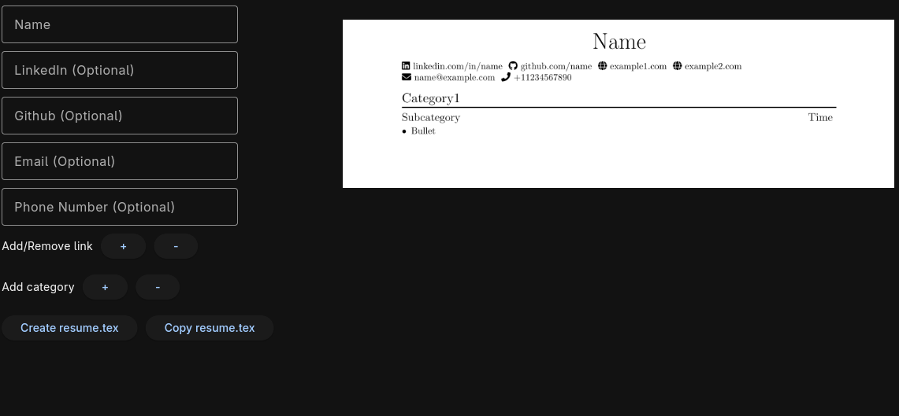

# ResumeBuilder

Submission for Temple University, Japan Campus' 2026 Hackathon, ResumeBuilder is a quick and easy way to display your skills in a nicely formatted PDF file using LaTeX. Python as a backend and Flet as a front end.

## Libraries
Dependencies for ResumeBuilder are pathlib, requests, and flutter. For the created TeX file, fontawesome5, geometry, hyperref, and enumitem is used for styling.

## Usage

Input the relevant information you want displayed on your resume in the text boxes, and hit submit. The Program will automatically generate a .tex file, which can be used to compile to a PDF file via an external source like Overleaf.

## Installation
For executables, refer to the Releases page.

For running using Python, clone this repository.


```
git clone https://github.com/jfitzjr/ResumeBuilder.git
```
Change into the repository's directory.
```
cd ResumeBuilder
```
Install missing dependencies requests and flutter.
```
pip install requests flet
```
Run main.py
```
python src/main.py